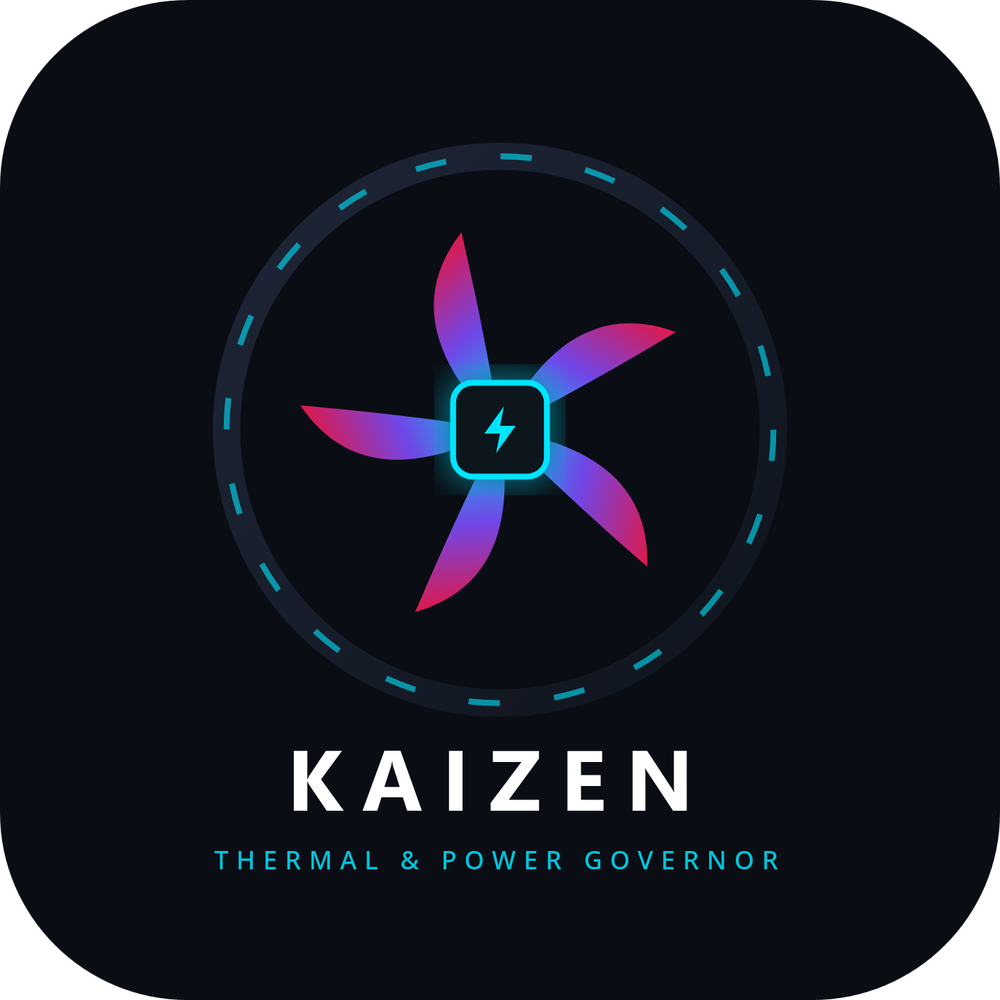

<p align="center">
  
</p>

<h1 align="center">Kaizen Power Tool</h1>

<p align="center">
  <b>Modern Linux Hardware & Cooling Management Suite</b><br>
  Complete control over CPU frequencies, GPU clocks & power, and cooling fan curves via D-Bus daemon, CLI, TUI, and GTK4 GUI.
</p>

---

## ⚡ Quick Start & Installation

### Arch Linux (AUR / PKGBUILD)
```bash
makepkg -si
```

### Manual Build (CMake)
```bash
sudo pacman -S gtk4 libadwaita ncurses glib2 systemd-libs gettext cmake pkgconf
cmake -B build -S . -DCMAKE_BUILD_TYPE=Release
cmake --build build -j$(nproc)
```

### Enable System Daemon (D-Bus)
```bash
sudo systemctl enable --now kaizend.service
```

---

## 🛠️ CLI Commands & Examples (`kaizenctl`)

### 1. Factory Auto Reset (`auto`)
Restore hardware components to factory automatic mode:
```bash
kaizenctl auto              # Restore all hardware (CPU, GPU, fans)
kaizenctl auto cpu          # Restore CPU governor to schedutil & enable Turbo
kaizenctl auto gpu          # Restore GPU power level to automatic
kaizenctl auto fans         # Restore all fans to firmware/BIOS curve
kaizenctl auto hwmon4_fan2  # Restore specific fan to auto mode
```

### 2. Query Hardware Metrics (`get`)
```bash
kaizenctl get summary       # System overview: OS, CPU, GPU, RPM, profile
kaizenctl get cpu           # CPU model, core frequencies, governor, limits
kaizenctl get gpu           # GPU clocks, temperatures, power draw (W)
kaizenctl get fans          # Fan RPM list and active PWM control modes
```

### 3. Hardware Configuration (`set`)

#### CPU Control
```bash
kaizenctl set cpu governor performance          # Scaling governor: performance, powersave, schedutil
kaizenctl set cpu epp balance_performance       # Energy preference: performance, balance_power, power
kaizenctl set cpu turbo on                      # Turbo Boost / Core Performance Boost: on, off
kaizenctl set cpu min 1.2                       # Minimum CPU limit in GHz
kaizenctl set cpu max 4.2                       # Maximum CPU limit in GHz
```

#### GPU Control (AMD / NVIDIA / Intel)
```bash
kaizenctl set gpu level high                    # DPM performance level: auto, low, high, manual
kaizenctl set gpu sclk 4                        # Lock GPU core clock (SCLK) state index
kaizenctl set gpu mclk 2                        # Lock GPU memory clock (MCLK) state index
kaizenctl set gpu profile 1                     # AMD PowerPlay profile: 0=Default, 1=3D, 2=Compute
```

#### Cooling Fan Control
```bash
kaizenctl set fan hwmon4_fan2 speed 70          # Set manual fan speed percentage (0-100%)
kaizenctl set fan hwmon4_fan2 mode curve        # Switch control mode: auto, simple, curve
kaizenctl set fan hwmon4_fan2 curve quiet       # Apply preset curve: quiet, balanced, aggressive
```

#### System Profiles
```bash
kaizenctl set profile silent                    # Quiet profile (Powersave CPU, low GPU, 30% fans)
kaizenctl set profile balanced                  # Balanced profile (Adaptive CPU/GPU, auto curve)
kaizenctl set profile performance               # Performance profile (Full CPU, high GPU, 80% fans)
kaizenctl set profile cooling                   # Max Cooling (All fans forced to 100% duty cycle)
```

---

## 📟 Interactive Terminal Dashboard (`kaizentui`)

Launch the Ncurses terminal interface:
```bash
kaizentui
# or
kaizenctl --tui
```

| Key | Action |
|:---:|:---|
| `A` | **Auto All** — Restore CPU, GPU, and Fans to factory automatic mode |
| `S` | **Silent Profile** — Low noise, power saving |
| `B` | **Balanced Profile** — Adaptive frequencies and balanced cooling |
| `P` | **Performance Profile** — Maximum clock speeds, high fan RPM |
| `M` | **Max Cooling Profile** — 100% duty cycle on all fans |
| `R` | **Refresh** — Instant telemetry update |
| `Q` | **Quit** |

---

## 🖥️ Graphical Interface (`kaizengui`)

Launch the modern GTK4 / Libadwaita desktop application:
```bash
kaizengui
kaizengui --tab fans        # Open directly to tab: summary, fans, cpu, gpu, profiles
kaizengui --lang ru         # Force language: en, ru, kk, ky, tr, uz
```

---

## 📄 License
GPL-3.0-or-later.
